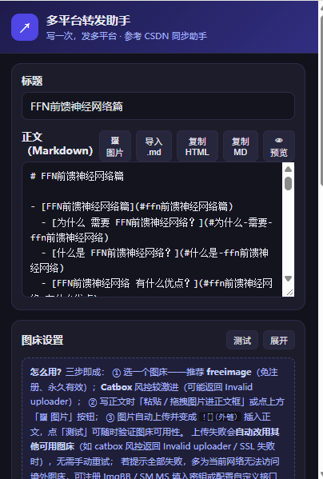
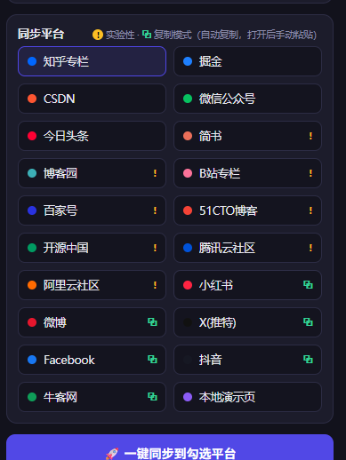

<div align="center">

# 多平台转发助手 · MultiPost Sync

**写一次，发多平台 —— 浏览器插件版的「CSDN 同步助手」**

在插件弹窗里写好 Markdown，勾选目标平台，一键同步到知乎、掘金、CSDN、公众号等
20+ 内容平台的编辑器；自动打开编辑页、自动填充标题与正文，发布前留人工确认。


<br/>

<table>
  <tr>
    <td align="center"><br/><sub><b>弹窗主页</b>：写文章、插图床、选主题</sub></td>
    <td align="center"><br/><sub><b>同步平台</b>：勾选即同步，一键分发</sub></td>
  </tr>
</table>

</div>

## 它是怎么工作的

```
┌────────────┐   START_JOB    ┌──────────────────┐   打开编辑页   ┌─────────────┐
│  Popup     │ ─────────────> │  Background      │ ────────────> │ 平台标签页    │
│  写文章+勾选 │               │  Service Worker  │               │ 知乎/掘金/CSDN│
└────────────┘ <───────────── │  任务编排器       │ <──────────── └─────────────┘
                              └──────────────────┘  FILL_RESULT
                                                        ↑ Content Script 按平台适配器自动填充
                                                          标题 + 正文，页面右上角显示进度浮层
```

- **浏览器插件形态**：直接复用你在浏览器里已登录的各平台会话，不碰账号密码，不依赖平台开放 API。
- **半自动发布**：插件自动打开各平台编辑页并填充标题/正文，**最终发布由你人工确认点击**——
  避免各平台发布弹窗（分类/标签/封面设置）差异导致误发，也更不容易触发风控。
- **任务不丢**：任务持久化到 `chrome.storage.session` + 事件驱动泵。Service Worker 被浏览器
  回收后自动恢复任务继续跑，1 分钟看门狗 alarm 兜底超时——勾了 N 个平台就不会只同步两三个。

## ✨ 核心特性

- **编辑器级精准填充**：按编辑器类型自动选择策略，杜绝「浮层显示成功、内容实际为空」的假阳性——
  - Markdown 编辑器（掘金/CSDN/腾讯云）优先主世界直写 CodeMirror 5/6 实例（`setValue` / `EditorView.dispatch`）；
  - 富文本编辑器（知乎 DraftJS / 公众号 ProseMirror / 头条）走合成 paste 事件注入 HTML，多级选择器兜底；
  - 所有填充模式平台失败时自动把内容复制到剪贴板（复制兜底），手动 `Ctrl+V` 即可，不再两手空空。
- **LaTeX 公式支持**：正文中的 `$$...$$` 公式自动渲染为图片（MathJax 优先，codecogs PNG 兜底），
  解决知乎/公众号等不支持 LaTeX 的平台显示源码的问题；代码块内的 `$` 不受影响。
- **多平台兼容性打磨**：主世界注入站点权限齐全、标题字段护栏（防止正文误粘进标题框）、
  DraftJS 空段落清理、编辑器深搜兜底等，详见[更新里程碑](#-更新里程碑)。
- **12 套排版主题**（参考 mdnice/wemd）：弹窗「👁 预览」实时按主题渲染；
  勾选「同步套用」后主题样式内联进富文本平台（公众号/知乎/头条）的 HTML，排版跨平台保留。
- **图床上传**：弹窗里直接粘贴 / 拖拽 / 选择图片，自动上传图床并在光标处插入外链 Markdown，
  所有平台同步使用同一份外链。
- **复制模式**：小红书、微博、X 等「无网页文章编辑器或结构不稳定」的平台，同步时把
  「标题+正文」写入剪贴板并自动打开平台页面，手动粘贴即可。
- **诊断日志**：任务流转、各平台填充结果、图床上传全链路写本地日志（保留最近 800 条），
  弹窗「🧾 导出日志」下载 .txt 排查。

## 🌐 支持平台

**填充模式**（自动打开编辑页并填充标题/正文，人工确认发布）：

| 平台 | 编辑器类型 | 状态 |
|---|---|---|
| 知乎专栏 | 富文本 (DraftJS) | ✅ 稳定 |
| 掘金 | Markdown (CodeMirror 6) | ✅ 稳定（主世界 CM6 直写 + 主世界 paste 兜底） |
| CSDN | Markdown (CodeMirror 6) | ✅ 稳定（主世界 CM6 实例直写，富文本模式自动兜底） |
| 微信公众号 | 富文本 (ProseMirror) | ✅ 稳定（自动提取 token 跳转编辑页） |
| 今日头条 | 富文本 | ⚠️ 平台改版频繁，失效时需更新选择器 |
| 简书 | Markdown/富文本 | ⚠️ 实验性 |
| 博客园 | Markdown/富文本 | ⚠️ 实验性（需账号已开通博客功能） |
| B站专栏 | 富文本 (Quill) | ⚠️ 实验性 |
| 百家号 | 富文本 | ⚠️ 实验性 |
| 51CTO博客 | Markdown/富文本 | ⚠️ 实验性 |
| 开源中国 | Markdown/富文本 | ⚠️ 实验性 |
| 腾讯云社区 | Markdown (CodeMirror) | ⚠️ 实验性 |
| 阿里云社区 | Markdown/富文本 | ⚠️ 实验性 |
| 本地演示页 | Markdown | 用于本地验证链路 |

**复制模式**（内容自动复制到剪贴板 → 打开平台页面 → 手动 `Ctrl+V` 粘贴）：

<p>小红书 · 微博 · X(推特) · Facebook · 抖音 · 牛客网</p>

> 平台前端改版会导致选择器失效，这是此类工具的固有问题。失效时到
> `extension/content/adapters/index.js` 对应适配器里补充新选择器即可。

## 📦 安装（Chrome / Edge / Arc 等 Chromium 浏览器）

1. 下载本项目代码（`Code → Download ZIP` 或 `git clone`），解压；
2. 打开 `chrome://extensions/`，右上角开启「开发者模式」；
3. 点「加载已解压的扩展程序」，选择项目的 `extension/` 目录；
4. 固定插件到工具栏，点开图标即可使用。

## 🚀 五分钟验证全链路（不依赖任何平台账号）

```bash
# 在项目根目录启动本地演示页（端口必须是 8788）
cd demo && python -m http.server 8788
# 或: npx serve -l 8788
```

1. 打开插件弹窗，标题和正文随便写点什么；
2. 只勾选「本地演示页」→ 点「🚀 一键同步」；
3. 会自动打开 `http://localhost:8788/demo-editor.html`，标题和正文被自动填充，
   页面右上角出现绿色「填充完成 ✓」浮层。

## 🖼 图床：图片上传与全平台同步

弹窗「正文」框内支持三种方式插图：

1. **粘贴**：截图后直接 `Ctrl+V` 到正文框；
2. **拖拽**：把图片文件拖进正文框；
3. **按钮**：点「🖼 图片」选择本地图片。

图片会自动上传到图床并在光标处插入 ``，随后同步到所有勾选平台时使用同一份外链。

图床配置（弹窗「图床设置」）：

| 图床 | 注册 | 数量限制 | 单图上限 | 说明 |
|---|---|---|---|---|
| **Catbox**（默认推荐） | 免注册 | 无 | 200MB | 永久有效；个别网络 SSL 握手会失败，换 freeimage 即可 |
| **freeimage.host** | 免注册（内置公共 Key） | 无 | 32MB | 永久有效；公共 Key 失效可免费注册换专属 Key |
| **ImgBB** | 免费注册领 Key | 无 | 32MB | 永久有效，api.imgbb.com → Dashboard → API |
| **SM.MS** | 免费注册领 Token | 有限速 | 5MB | ⚠️ 匿名上传已被官方停用（返回「未授权」），必须填 Token（Basic 认证） |
| **自定义接口** | — | — | — | POST 地址 + 可选鉴权 Header + JSON 链接字段路径（默认 `data.url`），需 `multipart/form-data`、字段名 `file` |

点「测试」按钮可一键上传 1x1 测试图验证图床可用性。

## 🧩 项目结构

```
extension/
├── manifest.json              # MV3 清单
├── common/platforms.js        # 平台注册表（三端共用）
├── common/themes.js           # 主题系统（预览 CSS + 富文本内联样式）
├── common/formulas.js         # LaTeX 公式渲染（MathJax + codecogs PNG 兜底）
├── background/service-worker.js  # 任务编排：任务持久化 + 事件驱动泵 + 日志
├── popup/                     # 弹窗：编辑器 + 预览 + 平台勾选 + 进度 + 历史 + 日志导出
├── content/
│   ├── inject-common.js       # 注入工具：等待/受控赋值/合成粘贴/主世界CM直写/MD转HTML
│   ├── adapters/index.js      # ★ 各平台适配器（维护重点）
│   ├── main.js                # 内容脚本入口：领任务 → 填充 → 浮层反馈
│   └── overlay.css
└── lib/marked.min.js          # Markdown → HTML
demo/demo-editor.html          # 本地演示编辑器
tools/gen_icons.py             # 图标生成脚本
tools/test-pump.js             # 编排器冒烟测试（node tools/test-pump.js）
```

## 🔧 如何新增一个平台

1. 在 `extension/common/platforms.js` 登记平台：`id / name / editorUrl / hosts / color`；
2. 在 `extension/content/adapters/index.js` 实现适配器：

```js
const myplatform = {
  id: 'myplatform',
  name: '我的平台',
  hosts: ['write.myplatform.com'],
  async fill(ctx) {                       // ctx: { title, markdown, html, util }
    const title = await U.fillTitle({ title: ctx.title, selectors: ['input[placeholder*="标题"]'] });
    const body  = await U.fillMarkdown({ markdown: ctx.markdown, selectors: ['textarea.editor'] });
    return { ok: title.ok && body.ok, message: '' };
  }
};
```

3. 在 `manifest.json` 的 `content_scripts.matches` 和 `host_permissions` 中加上该平台编辑页的 URL。

工具集（`window.__MULTIPOST_UTIL__`）已封装：`fillTitle` / `fillMarkdown` / `fillRichText` /
`waitFor` / `setNativeValue` / `firePaste` / `mdToHtml`，覆盖 CodeMirror5/6、ProseMirror、
DraftJS、UEditor、TinyMCE、Quill 等常见编辑器的填充方式。

## 🧭 更新里程碑

### v0.4.x —— 平台兼容性大幅加固

- **公众号**：修复正文空（隐藏 UEditor iframe 假阳性）、正文误粘进标题框（标题字段护栏
  `looksLikeTitleField` + 选择器全部正文限定 + 标题污染恢复）；编辑器挂载慢时深搜兜底（45s）；
  无 token 链接被重定向时自动提取 token 跳转编辑页。
- **知乎**：修复 DraftJS 产生的多空行/空段落（无 `<br>` 块级 HTML + 嵌套列表提升
  `hoistNestedLists` + 粘贴后空块清理）；LaTeX 公式自动转图（知乎拒收 SVG，改用 PNG）。
- **掘金/CSDN**：CodeMirror 6 的实例只存在于页面主世界，内容脚本隔离世界不可见——
  通过 `chrome.scripting` 注入主世界直写 CM 实例，再以合成 paste/textarea 兜底。
- **简书**：修复标题填充失败（哈希类选择器失效，改为特征查找）。
- **新增 12 个平台**：填充模式 6 个（B站专栏/百家号/51CTO/开源中国/腾讯云/阿里云），
  复制模式 6 个（小红书/微博/X/Facebook/抖音/牛客网）。
- **复制兜底**：所有填充模式平台失败时，自动复制内容到剪贴板并提示「Ctrl+V 手动粘贴」。

### v0.3 —— 可靠性与体验

- **任务持久化**：Service Worker 被回收后自动恢复任务继续跑（修复「勾了 N 个平台只同步两三个」）。
- **主题排版**：内置 12 套主题，弹窗实时预览，富文本平台样式内联（mdnice 核心做法）。
- **浮层优化**：可拖拽/可关闭/可最小化，成功后自动收起，不挡「发布」按钮。
- **图床上传体验**：多图与整卡拖拽、实时状态反馈、「测试」按钮、三步使用引导。
- **诊断日志**：全链路本地日志（最近 800 条），一键导出 .txt 排查。

## ⚠️ 风险与边界

- 本工具只做「内容填充」，发布动作保留人工确认，避免误发和触发平台风控。
- 各平台对自动化操作的态度不同，请勿高频批量发布。
- 选择器属于前向不兼容的脆弱层，平台改版需自行更新适配器。

## 🤝 贡献

欢迎提 Issue 反馈某平台的失效表现（附「🧾 导出日志」的 .txt 文件），或 PR 补充/修复平台适配器。
